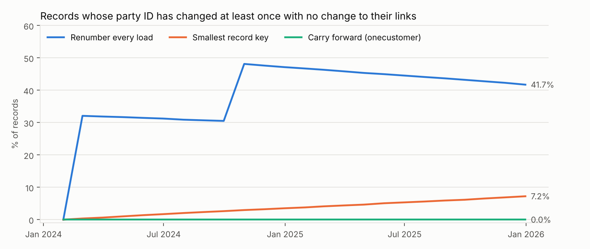

# onecustomer

[](https://github.com/NthabiM-07/onecustomer/actions/workflows/ci.yml)

[](LICENSE)

**A customer master that finds the same person in two source systems, gives them one party ID that
stays put, and keeps every version of what the bank knew about them.**

A bank's lending platform and its card platform each keep their own customer records. They share no
key. The loans platform was captured in branches: upper-case names, IDs nearly always present, phone
numbers that go stale. The cards platform was onboarded through an app: tidy emails, but nicknames
instead of legal names, no ID on about one record in six, and the odd day and month swapped. The
same person is "BOITUMELO MOKOENA" in one and "Tumi Mokoena" in the other.

Get the match wrong in one direction and a customer's debt is split across two parties, so
affordability and exposure limits see only part of it. Get it wrong in the other direction and two
people share a party: one person's arrears decline the other's application, and one customer's
details are shown to another. Then, even with perfect matches, the party ID has to survive every
monthly re-match, or every system keyed on it loses the customer's history.

`onecustomer` handles all three: probabilistic matching with constraints, party keys carried forward
with a crosswalk, and an SCD Type 2 golden record with column-level lineage.


10,000 synthetic people hold 14,946 accounts (7,691 loans, 7,255 cards) across 24 monthly loads.
Each approach below uses the same blocking and the same clustering code. Scores are for the
December 2025 load against the ground truth the generator kept back:

| Approach | Precision | Recall | Customers split | Customers falsely merged | Twin pairs merged | Multi-product customers with the wrong total exposure |
|---|---|---|---|---|---|---|
| Exact ID only | 100.00% | 79.77% | 961 | 0 | 0 of 77 | 20.3% |
| Deterministic rules | 91.32% | 99.43% | 29 | 361 | 3 of 77 | 5.2% |
| Fellegi-Sunter weights only | 90.12% | 99.92% | 4 | 423 | 66 of 77 | 5.4% |
| + trusted-ID cannot-link | 99.41% | 99.92% | 4 | 40 | 5 of 77 | 0.3% |
| **+ identity guard (onecustomer)** | **99.96%** | **99.73%** | **13** | **4** | **0 of 77** | **0.3%** |

Precision and recall are over record pairs. Three things stand out:

- **Exact-ID matching looks safe and isn't.** It never merges two people, but it leaves 961
  customers split. R17.2m of balances sits on parties other than the one carrying each customer's
  largest account, so one multi-product customer in five has the wrong total exposure.
- **Probabilistic weights on their own merge more people than the rules do.** Fellegi-Sunter
  treats each field as independent evidence. Twins share a surname, birth date, address and often a
  phone number, so the model adds those up and merges 66 of 77 twin pairs. The fix is not a bigger
  model. It is two constraints: never put two different trusted IDs in one party, and never link
  two records unless the first name or the ID agrees. False merges fall from 423 to 4.
- **The constraints cost recall, on purpose.** The guard leaves 13 customers split instead of 4.
  A split customer is a visible gap a data steward can review. A false merge is invisible and harms
  someone else ([ADR 0002](docs/adr/0002-cannot-link-and-identity-guard.md)).

Across all 24 monthly loads, pairwise precision never fell below 99.81% and recall never below
99.70%. All numbers come from [`reports/results.json`](reports/results.json); the full report is in
[`reports/report.md`](reports/report.md).

---

## Party IDs that stay put

The matcher re-clusters the whole book after every load. Clusters are anonymous, so something has to
decide which `party_id` each one carries. A feature store, a collections queue and a regulatory return
all join on that ID.



Over 24 loads, using the same clusters each time:

| Keying | Party ID changes | Caused by a real merge or split | With no change in links | Crosswalk rows |
|---|---|---|---|---|
| Renumber every load (identity column) | 77,332 | 45 | 77,287 | 0 |
| Smallest source key in the cluster | 1,126 | 45 | 1,081 | 0 |
| **Carry forward by overlap (onecustomer)** | **45** | **45** | **0** | **45** |

Carry-forward gives each new cluster the ID of the previous party it shares most records with. When
two parties merge, the ID of the party contributing more records survives (the older one on a tie),
and the other gets a `merged_into` crosswalk row. When a party splits, the larger part keeps the ID
and the new part gets a `split_from` row. `onecustomer
audit` checks that every retired ID has a crosswalk row and that following them always ends at a
live party ([ADR 0003](docs/adr/0003-stable-party-keys.md)).

The smallest-key approach looks deterministic, but cards keys (`CD…`) sort before loans keys
(`LN…`). Every time a loans-only customer opens a card, the party ID changes.

## History you can audit

Every party is kept as an SCD Type 2 table. A new version opens when any golden attribute or the set
of member records changes, and `change_reason` says which. Closing a version only sets its
`valid_to`; nothing is rewritten.

- **Point-in-time answers.** Over 206,508 party-months, a table that overwrites in place (SCD1)
  gives the wrong address 12.7% of the time and the wrong phone number 8.6% of the
  time when asked what the bank held in a given month.
- **Proven append-only.** `onecustomer replay --month M` rebuilds the master from scratch using only
  loads up to month M and compares it with the final table read as of M. Rebuilds through months 8
  and 16 match exactly, party for party and value for value. CI runs the same check on every push.
- **Column-level lineage.** Every golden value is copied from one source record, and the `lineage`
  column says which. Identity comes from the KYC-ranked record. Surname comes from the most recent
  update after onboarding (a marriage reaches one system before the other). Contact details come
  from the most recent change ([ADR 0004](docs/adr/0004-scd2-survivorship-lineage.md)).

A party found through its loans record (`onecustomer lookup LN0006169`). Priya opened a card in
January 2024, a loan in October 2024, and married in January 2025:

```
   party_id  version valid_from_date valid_to_date       change_reason first_name        surname   systems  total_exposure
PTY00001005        1      2024-01-31    2024-10-31             created      Priya        Khumalo     cards        34434.71
PTY00001005        2      2024-10-31    2025-01-31 records,middle_name      Priya        Khumalo cards+loans        50134.14
PTY00001005        3      2025-01-31           NaN             surname      Priya Khumalo-Naidoo cards+loans        50134.14

lineage: {"address": "LN0006169", "date_of_birth": "LN0006169", "email": "LN0006169", "first_name": "LN0006169",
          "middle_name": "LN0006169", "national_id": "LN0006169", "phone": "LN0006169", "surname": "LN0006169"}
```

`--as-of 2024-06` returns version 1 only: the card, and the surname she had then.

---

## How the matching works

```
source versions ──► standardise ──► block ──► compare ──► Fellegi-Sunter weights ──► constrained clustering
                    (once per        (6 rules)  (7 fields,    (u from random pairs,        (strongest link first,
                     version)                    graded)       m by EM, no labels)          cannot-link, guard)
```

**Standardise.** Names are upper-cased and stripped of punctuation. First names are folded through
a nickname table (BOITUMELO and TUMI become one form). Surname particles collapse (`van der Merwe`,
`VANDERMERWE` and `VD MERWE` are one surname), and double-barrelled surnames are split into parts.
Phones go to national format (`+27 82 123 4567` becomes `0821234567`). An SA ID is **valid** if it
passes the Luhn check and encodes a real date, and **trusted** if it is valid and its birth date
matches the captured one. Luhn catches every single-digit typo and almost every swap of adjacent
digits, so a mistyped ID is almost never trusted.

**Block.** Pairs are compared only if they share an ID, a phone, an email, a birth date and surname
initial, a birth date and first name, or a full name and birth year. Blocks above 50 records are
skipped; a shared call-centre number carries no information.

**Compare.** Each pair gets a level per field:

| Field | Levels (best first) |
|---|---|
| National ID | same; one digit wrong or two swapped; different |
| Date of birth | same; day and month swapped or one part different; different |
| First name | same after nickname folding; matches the other's middle name or Jaro-Winkler ≥ 0.92; different |
| Surname | same; shares part of a double-barrelled name or Jaro-Winkler ≥ 0.92; different |
| Phone, email | same; different |
| Address | same line and postal code; same line, or same postal code and a similar line; different |

A field missing on either side carries no evidence.

**Learn the weights without labels.** u (how often a level occurs among non-matches) comes from
100,000 random record pairs. m (how often it occurs among matches) comes from EM with u held fixed,
in three training sessions blocked on birth date, phone and full name. Each session leaves out the
fields its block forces to agree. The prior comes from the session priors and each rule's measured
recall. The weights for the final load, as log2 Bayes factors from worst level to best:

| Field | Different | Partial | Same |
|---|---|---|---|
| National ID | −4.9 | +9.8 | +13.7 |
| Date of birth | −4.8 | +2.2 | +12.9 |
| First name | −4.1 | +2.7 | +6.5 |
| Surname | −6.3 | +3.3 | +4.5 |
| Phone | −3.3 | | +14.2 |
| Email | −3.8 | | +13.6 |
| Address | −4.2 | +0.0 | +12.8 |

Exact agreement on a near-unique value (ID, phone, email) is worth 13 to 14 bits. Such agreements
almost never occur among 100,000 random pairs, so their u comes from add-one smoothing. That makes
these weights a floor set by the sample size, not a measurement. Two earlier training designs
failed, and [ADR 0001](docs/adr/0001-fellegi-sunter-with-fixed-u.md) records why.

**Cluster.** Links with a posterior of at least 0.9 are joined strongest first, under the cannot-link
and the identity guard. The threshold matters less than the constraints: anything from 0.5 to 0.999
gives 4 false merges, with 9 to 24 split customers.

## Quick start

```bash
pip install -e ".[dev]"

onecustomer generate --people 10000 --seed 7   # synthetic world -> data/
onecustomer run                                # match, key and historise 24 loads
onecustomer audit                              # SCD2 invariants and crosswalk coverage
onecustomer lookup LN0006169                   # a party, found by any of its source records
onecustomer lookup PTY00001005 --as-of 2024-06 # the same party as the bank held it in June 2024
onecustomer replay --month 12                  # rebuild through month 12 and compare
onecustomer experiment                         # reports/results.json, report.md and both charts

pytest                                         # 44 tests
```

`make demo` runs everything above except the experiment and the tests. The full experiment takes
about two minutes on a laptop.

## Repository layout

```
src/onecustomer/
  generate.py      synthetic world: households, two source systems, 24 loads of change
  sa_id.py         SA ID numbers: Luhn check digit, birth date, validation
  standardise.py   names, nicknames, surname particles, phones, emails, addresses, IDs
  match.py         blocking, comparison levels, EM training, constrained clustering, baselines
  keys.py          rebuild, anchor and carry-forward keyings; crosswalk; churn
  history.py       survivorship, lineage, SCD2 build, as_of, audit
  pipeline.py      month-by-month runs using only data loaded so far
  evaluate.py      pairwise scores, split and merged customers, exposure errors
  experiment.py    everything in reports/
  cli.py           the onecustomer command
docs/adr/          four design decisions
docs/data_dictionary.md
```

## What is synthetic and what is not

Everything is synthetic. No real customer, account or ID number is used. The ID numbers are generated
with valid structure and check digits, but they come from synthetic birth dates and random sequence
numbers. The capture errors, life events and update lags are rates chosen to resemble a South
African retail book; they are not measured from one. This repository contains no employer code,
data or system names.

What carries over is the mechanism: how each strategy fails, why constraints beat a bigger model
for households, why key churn is a separate problem from matching, and how to prove history is never
rewritten. The exact percentages are not a forecast for any real portfolio.

## Limitations

- **The nickname table is shared with the generator.** Every nickname the generator uses is one the
  matcher knows, so nickname matching is easier here than in production, where the table is never
  complete.
- **A typo on the KYC record is inherited.** Identity fields come from the KYC-ranked record. When
  that record has the misspelling and the app record has it right, the golden record keeps the
  misspelling; survivorship cannot know which spelling is correct without an outside source.
- **Parent and child with the same name.** The 4 remaining false merges are two parent-and-child
  pairs with the same first name, address and phone, where the parent's record has no ID.
- **Flapping.** A weak link can drop below the threshold one month and come back later, so a party
  splits and then re-merges. Both events are in the crosswalk, but a stickiness rule (keep an
  existing link unless it falls well below the threshold) would reduce them.
- **Scale.** Comparisons run in Python with a cache keyed on record versions. That is fine for
  15,000 records and 24 loads. A production book would push comparison into SQL or Spark.
- **Monthly grain.** History is kept per load. A change made and reversed within a month is not
  visible, which matches how the sources deliver data.

## Related

This is the second project in a series. [timefence](https://github.com/NthabiM-07/timefence) builds
point-in-time correct credit features keyed on a customer ID. This repository is where a stable
customer ID comes from.

## Licence

MIT
