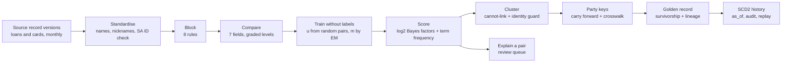
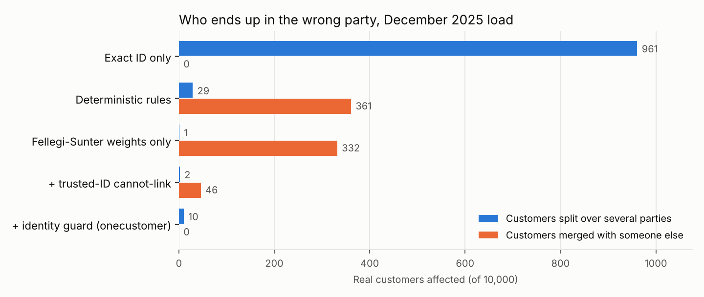
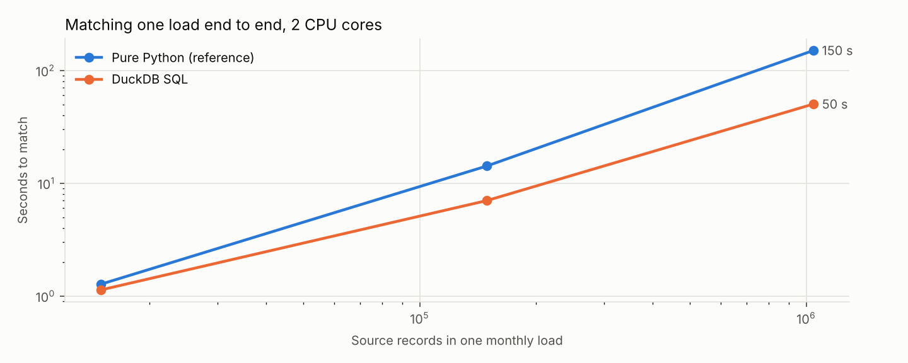

# onecustomer

[](https://github.com/NthabiM-07/onecustomer/actions/workflows/ci.yml)

[](LICENSE)

**A customer master for a bank: find the same person across source systems, give them one party ID
that stays put through every re-match, and keep every version of what the bank knew about them.**

A bank's lending platform and its card platform each keep their own customer records, with no shared
key. The same person is "BOITUMELO MOKOENA" in one and "Tumi Mokoena" in the other, and one record in
six on the cards side has no ID number. Miss a match and a customer's debt is split across two
parties, so affordability checks see only part of it. Make a false match and one person's arrears
decline another person's application. Then, even with perfect matches, the party ID has to survive
every monthly re-match, or every system keyed on it loses the customer's history.

## Results at a glance

| Question | Result | Evidence |
|---|---|---|
| Does the matcher work on data it did not generate? | FEBRL4 public benchmark: **100.00% precision, 98.56% recall**. Splink 5 on the same data: 100.00% and 99.22% | [`reports/febrl4.md`](reports/febrl4.md) |
| Does it keep different people apart? | 10,000-person South African book: **0 customers falsely merged**, 0 of 77 twin pairs merged, 10 customers left split | [`reports/report.md`](reports/report.md) |
| Do party IDs stay put? | **0 party ID changes without a real merge or split** over 24 monthly loads. Renumbering every load changed 74,879 | ADR [0003](docs/adr/0003-stable-party-keys.md) |
| Can you prove what the bank knew, and when? | An overwrite (SCD1) table gives the wrong address for **12.7%** of point-in-time lookups. The SCD2 history rebuilds exactly from scratch | ADR [0004](docs/adr/0004-scd2-survivorship-lineage.md) |
| Does it scale? | **1,044,396 records matched in 50 s** on 2 CPU cores with the DuckDB engine, results identical to the Python reference | ADR [0006](docs/adr/0006-duckdb-engine.md) |

Every figure comes from a file in [`reports/`](reports/) and a command you can rerun.

## What it adds to a matching library

Matching is the well-trodden part. onecustomer's matcher follows the same Fellegi-Sunter training
recipe as [Splink](https://github.com/moj-analytical-services/splink), and Splink is its baseline on
public data. The parts around matching are what a customer master needs and what open-source
libraries leave to the user:

| Capability | onecustomer | Splink | Zingg Community | dedupe | recordlinkage |
|---|---|---|---|---|---|
| Unsupervised Fellegi-Sunter training | Yes | Yes | No (active learning) | No (active learning) | Yes (ECM) |
| Term-frequency adjustments | Yes | Yes | n/a | No | No |
| Per-pair explanation (waterfall) | Yes, CLI | Yes, charts | Enterprise | No | No |
| Clustering constraints | Trusted-ID cannot-link, identity guard | No (connected components) | Yes | No (hierarchical clustering) | No clustering |
| Party IDs stable across re-runs, with a crosswalk | **Yes** | No: cluster ID is the smallest record ID | Enterprise only | No | No |
| Golden record with column-level lineage | **Yes** | No | Enterprise | Canonicalise only | No |
| SCD2 history with point-in-time queries | **Yes** | No | No | No | No |
| SQL execution | DuckDB | DuckDB, Spark, Athena and others | Spark | No | No |

Library capabilities are as described in their documentation and maintainers' discussions in
November 2026. The UK Ministry of Justice describes building its own stable-ID layer around Splink
in production ([blog](https://moj-analytical-services.github.io/splink/blog/2026/01/29/running-splink-in-production.html)).
This repository is that layer, in the open.

## How it fits together



Blocking and comparison run either in pure Python (the reference) or as SQL in DuckDB. A test
requires the two to produce identical comparison vectors.

---

## 1. Public benchmark: FEBRL4

FEBRL4 is two files of 5,000 synthetic Australian person records from Christen's FEBRL generator,
with 5,000 true links. It ships with the `recordlinkage` package, and this repository did not
generate it. onecustomer runs with its default settings. Splink 5 follows the training recipe of
Splink's FEBRL4 tutorial; its comparisons and blocking rules are this repository's choice, set before
looking at the results and not tuned on the labels.

| System (threshold 0.9) | Precision | Recall | F1 | B-cubed F1 |
|---|---|---|---|---|
| **onecustomer** | 100.00% | 98.56% | 99.27% | 99.64% |
| onecustomer without the identity guard | 100.00% | 99.04% | 99.52% | 99.76% |
| Splink 5 | 100.00% | 99.22% | 99.61% | 99.80% |
| onecustomer, exact ID only | 100.00% | 91.22% | 95.41% | 97.76% |
| onecustomer, deterministic rules | 100.00% | 95.42% | 97.66% | 98.84% |

Splink finds 0.66 points more true links. The identity guard accounts for 0.48 of that: FEBRL counts
some records with a different given name *and* a different ID number as the same person, and the
guard refuses those links because in a bank they are usually siblings or twins. The first run scored
97.96% recall; [ADR 0005](docs/adr/0005-public-benchmark.md) records each change since and its
effect on both datasets. Blocking keeps 99.56% of true pairs.

## 2. The South African book

10,000 synthetic people hold 14,946 accounts (7,691 loans, 7,255 cards) across 24 monthly loads,
with capture typos, nicknames, missing and mistyped ID numbers, moves, marriages, cross-sell and
duplicates. The hard cases are deliberate: 77 twin pairs, 82 fathers and sons with the same name, and
household members whose phone number was captured on each other's records.



| Approach (December 2025 load) | Precision | Recall | B-cubed F1 | Customers split | Customers falsely merged | Twin pairs merged |
|---|---|---|---|---|---|---|
| Exact ID only | 100.00% | 79.77% | 96.55% | 961 | 0 | 0 of 77 |
| Deterministic rules | 91.32% | 99.43% | 98.96% | 29 | 361 | 3 of 77 |
| Fellegi-Sunter weights only | 92.15% | 99.98% | 99.14% | 1 | 332 | 55 of 77 |
| + trusted-ID cannot-link | 99.33% | 99.96% | 99.90% | 2 | 46 | 5 of 77 |
| **+ identity guard (onecustomer)** | **100.00%** | **99.79%** | **99.97%** | **10** | **0** | **0 of 77** |

- **Exact-ID matching looks safe and isn't.** It never merges two people, but it leaves 961 customers
  split and R17.2m of balances off the party that carries each customer's largest account: one
  multi-product customer in five has the wrong total exposure.
- **Weights alone merge households.** Twins share a surname, birth date, address and often a phone,
  and Fellegi-Sunter counts each as independent evidence. The fix is two constraints, not a bigger
  model: never put two different trusted IDs in one party, and never link unless the ID agrees or
  both the first name and birth date do ([ADR 0002](docs/adr/0002-cannot-link-and-identity-guard.md)).
- **Zero false merges is robust.** It holds at every threshold from 0.5 to 0.999, on every one of the
  24 monthly loads, and when the model is trained on the December 2024 load and frozen for a year
  (recall 99.71% instead of 99.79%). Precision on every monthly load was 100%; recall never fell
  below 99.66%.

## 3. Party IDs that stay put


| Keying, over 24 loads | Party ID changes | Caused by a real merge or split | With no change in links | Crosswalk rows |
|---|---|---|---|---|
| Renumber every load (identity column) | 74,901 | 22 | 74,879 | 0 |
| Smallest source key in the cluster | 1,102 | 22 | 1,080 | 0 |
| **Carry forward by overlap (onecustomer)** | **22** | **22** | **0** | **22** |

Each new cluster takes the ID of the previous party it shares most records with. A party absorbed in a
merge gets a `merged_into` crosswalk row; a part that splits off gets a new ID and a `split_from`
row. `onecustomer audit` checks that every retired ID has a crosswalk row and that following them
ends at a live party. The smallest-key approach is what Splink's cluster IDs do: cards keys (`CD…`)
sort before loans keys (`LN…`), so every time a loans customer opens a card, the ID changes.

## 4. History you can audit

Every party is an SCD Type 2 table. A version opens when a golden attribute or the set of member
records changes, `change_reason` says which, and closing a version only sets its `valid_to`.

- Over 206,536 party-months, an overwrite table gives the wrong address 12.7% of the time, and the
  wrong phone 8.6%, when asked what the bank held in a given month.
- `onecustomer replay --month M` rebuilds the master from scratch using only loads up to M and
  compares it with the final table read as of M. Rebuilds through months 8 and 16 match exactly. CI
  runs the same check on every push.
- Each golden value is copied from one source record, and the `lineage` column says which.

Priya opened a card in January 2024, a loan in October 2024, and married in January 2025
(`onecustomer lookup LN0006169`):

```
   party_id  version valid_from_date valid_to_date       change_reason first_name        surname   systems
PTY00001005        1      2024-01-31    2024-10-31             created      Priya        Khumalo     cards
PTY00001005        2      2024-10-31    2025-01-31 records,middle_name      Priya        Khumalo cards+loans
PTY00001005        3      2025-01-31          None             surname      Priya Khumalo-Naidoo cards+loans
```

`--as-of 2024-06` returns version 1 only: the card, and the surname she had then.

## 5. Explain a link, review the doubtful ones

`onecustomer explain` prints the match-weight waterfall for any two records. These two are a father
and son. The weights alone are certain they are one person; the identity guard is why they stay
apart:

```
$ onecustomer explain LN0002442 LN0004420
field    record A                  record B                  level                               weight     tf
prior                                                                                            -14.29
nid                                9211175228083             missing                              +0.00
dob      1955-06-27                1992-11-17                different                            -4.75
first    TIAAN                     TIAAN                     same (nicknames folded)              +6.51  +0.32
surname  KRUGER                    KRUGER                    same                                 +4.49  +2.85
phone    0747843599                0747843599                same                                +14.20
email    tiaan.kruger@yahoo.com    tiaan.kruger@gmail.com    different                            -3.80
address  65 MAIN ROAD              65 MAIN ROAD              same street and postal code         +12.83
total                                                                                            +18.36

posterior 1.0000 (above threshold)
identity guard: blocks this link
trusted IDs: no conflict
verdict: NO LINK
```

The guard also blocks some true matches, such as "Kat" and a mistyped "KATLEEGO" with no ID on one
side. `onecustomer review-queue` writes those cases to a CSV for a data steward: 439 pairs on the
December 2025 load, 267 vetoed by the guard despite a confident score and 172 with uncertain scores.

## 6. Scale



| Records in one load | Candidate pairs | Pure Python | DuckDB | Peak memory (Python / DuckDB) |
|---|---|---|---|---|
| 14,946 | 21,891 | 1.3 s | 1.1 s | 232 / 294 MB |
| 149,168 | 379,883 | 14.2 s | 7.0 s | 1,058 / 762 MB |
| 1,044,396 | 9,785,959 | 150.3 s | 50.3 s | 6,021 / 3,712 MB |

End to end on 2 CPU cores: standardise, block, compare, train, score and cluster. At a million
records both engines give precision 99.996% and recall 99.65%.

---

## How the matching works

**Standardise.** First names are folded through a nickname table (BOITUMELO and TUMI become one form),
surname particles collapse (`van der Merwe` = `VD MERWE`), phones go to national format, and an SA ID
is **trusted** only if its Luhn check digit is right and its encoded birth date matches the captured
one.

**Block.** Records are compared only if they share an ID, phone or email; a birth date with a surname
initial, a first name or a postal code; a full name and birth year; or a street and postal code.
Blocks above 50 records are skipped.

**Compare.** Each pair gets a graded level per field (ID, birth date, first name, surname, phone, email,
address). Partial levels cover one-keystroke ID errors, day/month swaps, middle names used as first
names, names captured the wrong way round, and double-barrelled surnames.

**Learn the weights without labels.** u comes from 100,000 random record pairs; m comes from EM with
u held fixed, in three training sessions that each leave out the fields their block forces to agree;
the prior comes from session priors scaled by each rule's measured recall. Exact name agreement is
adjusted for how common the name is. The learnt weights, as log2 Bayes factors:

| Field | Different | Partial | Same |
|---|---|---|---|
| National ID | −4.9 | +9.8 | +13.7 |
| Date of birth | −4.8 | +2.2 | +12.9 |
| First name | −4.1 | +2.7 | +6.5 |
| Surname | −6.3 | +3.3 | +4.5 |
| Phone | −3.3 | | +14.2 |
| Email | −3.8 | | +13.6 |
| Address | −4.2 | +0.0 | +12.8 |

Exact agreement on a near-unique value (ID, phone, email) is worth 13 to 14 bits. Such agreements
almost never occur among 100,000 random pairs, so their u comes from add-one smoothing; these weights
are a floor set by the sample size, not a measurement.

**Cluster.** Links with a posterior of at least 0.9 that pass the identity guard are joined strongest
first, never joining two different trusted IDs.

## Quick start

```bash
pip install -e ".[dev]"            # add ",bench" for the FEBRL4 benchmark with Splink

onecustomer generate --people 10000 --seed 7   # synthetic world -> data/
onecustomer run                                # match, key and historise 24 loads
onecustomer audit                              # SCD2 invariants and crosswalk chains
onecustomer lookup LN0006169                   # a party, found by any of its source records
onecustomer lookup PTY00001005 --as-of 2024-06 # the same party as the bank held it in June 2024
onecustomer explain LN0002442 LN0004420        # why two records are (not) linked
onecustomer review-queue                       # pairs for a data steward, as CSV
onecustomer replay --month 12                  # rebuild through month 12 and compare
onecustomer experiment                         # reports/results.json, report.md, charts
onecustomer benchmark                          # FEBRL4 with Splink -> reports/febrl4.md
onecustomer scale                              # timings up to a million records

pytest                                         # 57 tests (FEBRL4 needs the bench extras)
```

## Repository layout

```
src/onecustomer/
  generate.py      synthetic world: households, two source systems, 24 loads of change
  sa_id.py         SA ID numbers: Luhn check digit, birth date, validation
  standardise.py   names, nicknames, surname particles, phones, emails, addresses, IDs
  match.py         blocking, comparison levels, EM training, term frequency, constrained clustering
  duck.py          the same blocking and comparisons as DuckDB SQL
  keys.py          rebuild, anchor and carry-forward keyings; crosswalk; churn
  history.py       survivorship, lineage, SCD2 build, as_of, audit
  explain.py       match-weight waterfall and the steward review queue
  evaluate.py      pairwise, B-cubed and exact-cluster metrics; blocking pair completeness
  febrl.py         FEBRL4 benchmark with a Splink baseline
  scale.py         scaling benchmark
  experiment.py    everything in reports/
  cli.py           the onecustomer command
docs/adr/          six design decisions
docs/regulatory_mapping.md   POPIA, National Credit Act and audit obligations, mapped to features
docs/data_dictionary.md
```

## Prior art

- I. P. Fellegi and A. B. Sunter (1969), "A Theory for Record Linkage", *Journal of the American
  Statistical Association* 64(328): the probabilistic model used here.
- [Splink](https://github.com/moj-analytical-services/splink), UK Ministry of Justice: the training
  recipe (u from random sampling, m by EM per blocking session, prior from rule recall) and
  term-frequency adjustments follow Splink's design, and Splink is the FEBRL4 baseline.
- P. Christen, FEBRL, via the [`recordlinkage`](https://github.com/J535D165/recordlinkage) package:
  the public benchmark data.
- [Zingg](https://github.com/zinggAI/zingg) and [dedupe](https://github.com/dedupeio/dedupe):
  active-learning approaches to the same problem, not used here.

## What is synthetic

The South African book is synthetic. No real customer, account or ID number is used; ID numbers are
generated with a valid structure and check digit from synthetic birth dates. Capture errors, life
events and update lags are rates chosen to resemble a retail book, not measured from one. FEBRL4 is
also synthetic, but it was built by someone else, with a different corruption model, which is why it
is the headline benchmark. This repository contains no employer code, data or system names.

## Limitations

- **The nickname table is shared with the generator** for the South African data, so nickname
  matching is easier there than in production. FEBRL4 does not have this advantage.
- **The guard costs recall** where a record has both a mistyped first name and no ID. Those customers
  stay split and go to the review queue; there is no feedback loop yet that turns steward labels
  into permanent must-link or cannot-link rules.
- **Flapping.** A weak link can drop below the threshold one month and come back later, so a party
  splits and re-merges. Both events are in the crosswalk.
- **Only one public benchmark.** Harder public sets (North Carolina voters, DBLP-ACM) need downloads
  that this offline build does not make.
- **Monthly grain.** History is kept per load; a change made and reversed within a month is not seen.

## Related

This is the second project in a series. [timefence](https://github.com/NthabiM-07/timefence) builds
point-in-time correct credit features keyed on a customer ID. This repository is where a stable
customer ID comes from.

## Licence

MIT
